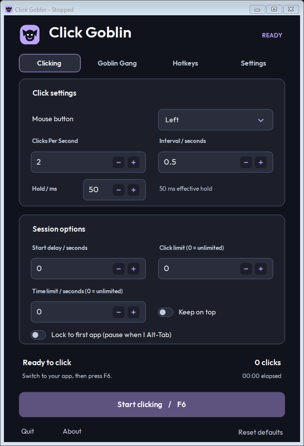
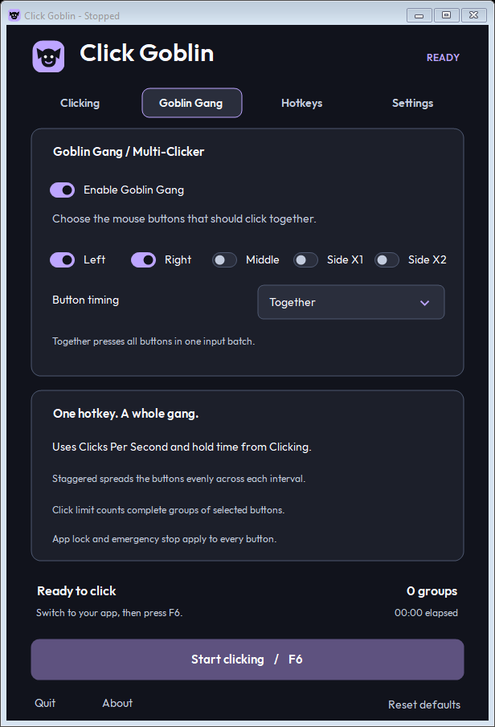
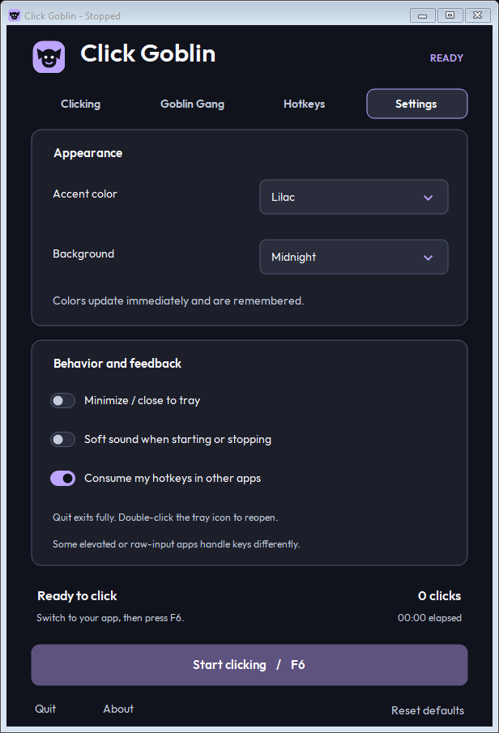

# Click Goblin

A lightweight Windows auto-clicker with multi-button patterns, live speed controls, and customizable colors. No installer.







Download the EXE, open it, choose your speed, and press **F6** to start or stop.

- Set **Clicks Per Second** or an interval; adjust speed from any app.
- Enable **Goblin Gang** for simultaneous or staggered mouse buttons.
- Choose hold times, countdowns, and limits. Customize 12 accents and 6 dark backgrounds.
- Optional toggle sounds, close-to-tray, and hotkeys that consume assigned shortcuts.
- Lock clicking to one app, pausing when you Alt-Tab.

**Default hotkeys:** F6 start/stop · F8 faster · F7 slower · F10 emergency stop. All are customizable.




App preview









Windows 10/11 with .NET Framework 4.8. Up to 500 Clicks Per Second per button requested; actual throughput depends on Windows and the receiving app. Starts stopped and saves settings locally. You may need to **Run as administrator** for some programs.

[Usage](docs/USAGE.md) | [Development](docs/DEVELOPMENT.md) | [MIT license](LICENSE) | [Font license](assets/fonts/OFL.txt)
